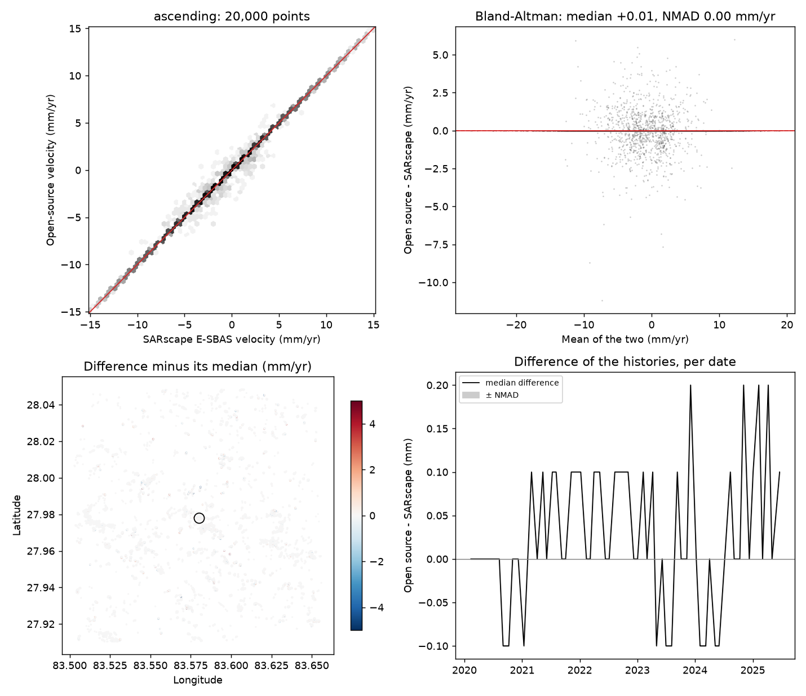
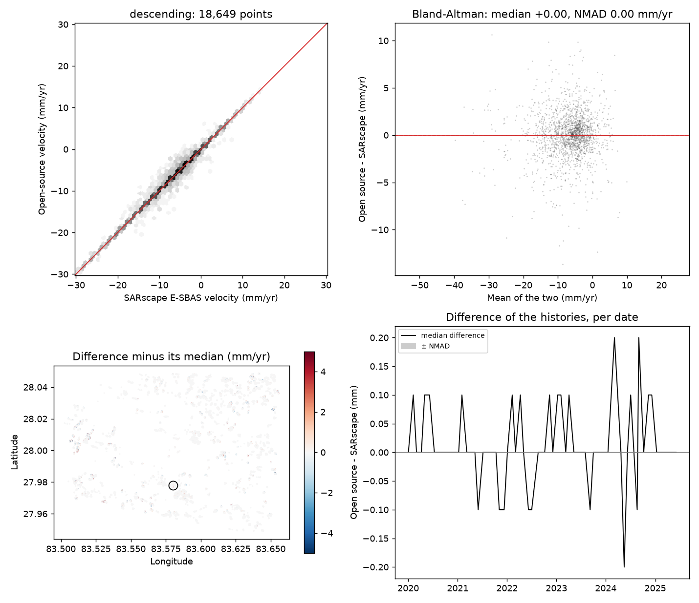
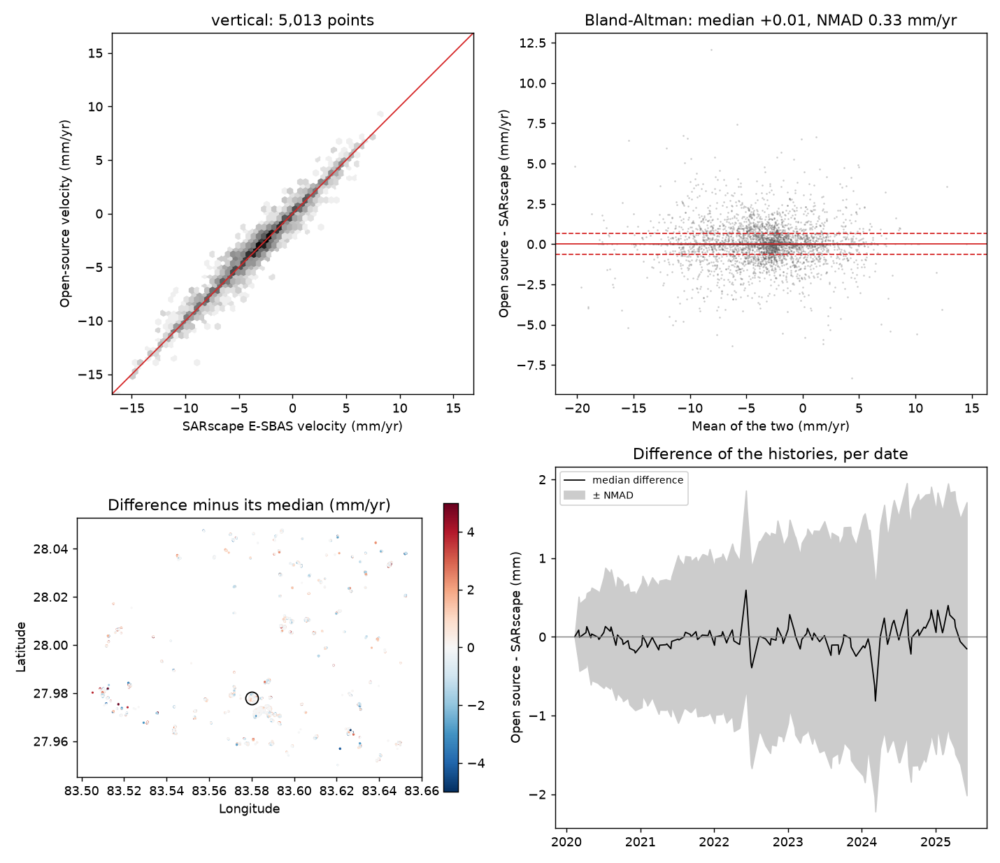
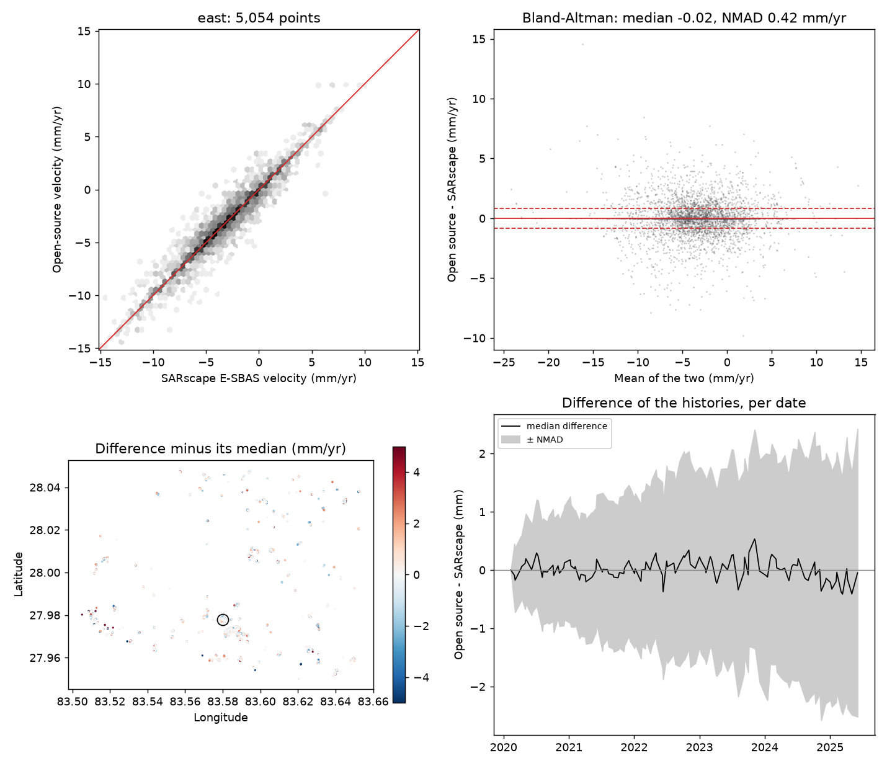
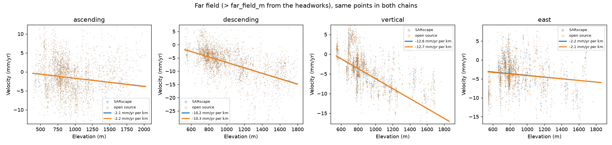

# SARscape E-SBAS vs open-source chain - variant 'synthetic'

Created 2026-11-20 14:42. Open-source chain: ISCE2 topsStack (SLC) -> MiaplPy (sequential_EMI, single_reference network) -> MintPy (troposphere: synthetic; DEM error correction: True). Common reference point of the open-source run: [27.9646, 83.5435]. Both chains re-referenced to the **headworks** median before comparison; velocities are least-squares rates over the common dates.

## 1. Coverage

| product | SARscape points | matched | share matched | open-source native points | common dates | SARscape dates | open-source dates | median sampling distance (m) |
|---|---|---|---|---|---|---|---|---|
| ascending | 20000 | 20000 | 1.000 | 8043 | 64 | 64 | 64 | 5.214 |
| descending | 18649 | 18649 | 1.000 | 6815 | 63 | 63 | 63 | 5.214 |
| vertical | 5645 | 5013 | 0.888 | 1237 | 124 | 124 | 124 | 6.161 |
| east | 5686 | 5054 | 0.889 | 1237 | 124 | 124 | 124 | 6.161 |

## 2. Velocity agreement (open source - SARscape, same points, same dates)

| product | points | median_difference_mm_yr | nmad_mm_yr | rmse_mm_yr | pearson_r | spearman_rho | orthogonal_slope | share_within_1_mm_yr | share_within_2_mm_yr |
|---|---|---|---|---|---|---|---|---|---|
| ascending | 20000 | 0.01 | 0.00 | 0.38 | 1.00 | 1.00 | 1.00 | 0.97 | 0.99 |
| descending | 18649 | 0.00 | 0.00 | 0.77 | 0.99 | 0.99 | 1.00 | 0.94 | 0.97 |
| vertical | 5013 | 0.01 | 0.33 | 1.10 | 0.96 | 0.96 | 0.99 | 0.79 | 0.93 |
| east | 5054 | -0.02 | 0.42 | 1.40 | 0.94 | 0.94 | 0.99 | 0.72 | 0.88 |

NMAD = 1.4826 x median absolute deviation of the difference (robust spread). orthogonal_slope = slope of the major axis of the open-source vs SARscape cloud (1 = same scale).

## 3. Agreement of the displacement histories

| product | points | median_rms_mm | p90_rms_mm | median_corr |
|---|---|---|---|---|
| ascending | 20000 | 0.08 | 0.08 | 1.00 |
| descending | 18649 | 0.07 | 1.34 | 1.00 |
| vertical | 5013 | 1.72 | 6.40 | 0.99 |
| east | 5054 | 2.23 | 8.25 | 0.99 |

The per-date median difference (common_mode_<product>.csv, lower-right panels) shows what differs across the whole window at once: residual atmosphere, reference handling or unwrapping.

## 4. Elevation dependence of the velocity (far field)

| product | chain | points | slope_mm_yr_per_km | ci95_low | ci95_high | spearman_rho |
|---|---|---|---|---|---|---|
| ascending | SARscape (matched points) | 3000 | -2.12 | -2.69 | -1.56 | -0.13 |
| ascending | open source (same points) | 3000 | -2.18 | -2.73 | -1.62 | -0.14 |
| ascending | open source (native points) | 3000 | -2.17 | -2.73 | -1.62 | -0.14 |
| descending | SARscape (matched points) | 3000 | -10.23 | -10.80 | -9.67 | -0.58 |
| descending | open source (same points) | 3000 | -10.30 | -10.87 | -9.75 | -0.58 |
| descending | open source (native points) | 3000 | -10.18 | -10.80 | -9.57 | -0.54 |
| vertical | SARscape (matched points) | 3000 | -12.63 | -13.24 | -12.03 | -0.64 |
| vertical | open source (same points) | 3000 | -12.65 | -13.26 | -12.05 | -0.65 |
| vertical | open source (native points) | 873 | -12.67 | -13.77 | -11.60 | -0.65 |
| east | SARscape (matched points) | 3000 | -2.23 | -2.94 | -1.52 | -0.10 |
| east | open source (same points) | 3000 | -2.11 | -2.82 | -1.39 | -0.10 |
| east | open source (native points) | 873 | -1.53 | -2.81 | -0.27 | -0.08 |

This is the test of the manuscript's Section 4.2: if the height-dependent bias is residual tropospheric stratification of the SARscape run, it should shrink with the weather-model variant ('pyaps' / 'gacos') of the open-source chain.

## 5. Geolocation check (offset scan)

| product | positions | east_m | north_m | nmad | nmad_at_0 | points |
|---|---|---|---|---|---|---|
| ascending | lon/lat fields | 0.00 | 0.00 | 0.00 | 0.00 | 20000 |
| descending | lon/lat fields | 0.00 | 0.00 | 0.00 | 0.00 | 18649 |
| east | geometry | 15.00 | 15.00 | 0.00 | 1.68 | 3218 |
| east | lon/lat fields | 0.00 | 0.00 | 0.00 | 0.00 | 3224 |
| vertical | geometry | 15.00 | 15.00 | 0.00 | 1.19 | 3177 |
| vertical | lon/lat fields | 0.00 | 0.00 | 0.00 | 0.00 | 3193 |

Shift of the sampling positions (m east / north) that minimises the spread of the velocity difference; nmad_at_0 is the spread without a shift. For the decomposed products the scan is made both at SARscape's lon/lat fields and at the shapefile geometry, which tests the ~22 m offset of the manuscript copies.

## 6. Answers of the agent on both product sets

See [answers_side_by_side_synthetic.md](../../answers/answers_side_by_side_synthetic.md).
